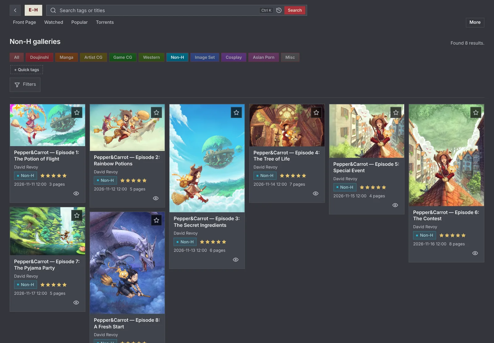

# Better EH

A full reskin of `e-hentai.org` and `exhentai.org`. Every page the script owns — search and
category listings, galleries, the reader, favorites, My Home, toplists, torrents, gallery torrents,
My Tags and settings — renders as one consistent, image-first interface instead of the site's
legacy tables. Routes it does not own stay native.



| Gallery                                                             | Reader                                              |
| ------------------------------------------------------------------- | --------------------------------------------------- |
|  |  |

Tag completion in the search bar — namespace-aware, popularity-ranked, and reachable from `f:`/`a:` aliases:


<sub>Screenshots use Pepper&amp;Carrot demo data by David Revoy (CC BY 4.0).</sub>

## Features

- **One shell**: owned routes share the sticky header, pagination, empty/error panel and SPA
  transitions, including back/forward and per-entry scroll restoration. A `?eh_native=1` link
  always falls back to the site's own page.
- **Search and browse**: a cover grid that keeps each gallery's real thumbnail aspect, with
  category chips, rating/date/page-count metadata, favorite marks, result counts, infinite scroll
  (per view) and the site's own seek/jump. Advanced filters and the panel state are remembered.
- **Posted-date range**: a posted-since/posted-until bound narrows a listing in-app. The range is
  app-owned (`eh_since`/`eh_until`) rather than a site filter, and the bound is applied
  client-side, so result counts are approximate.
- **Quick tags**: recent queries and named quick tags share the search field; every quick tag
  toggles its terms in the current draft, its editor uses the tag combobox, and active filter chips
  can be removed or flipped to include/exclude/optional without retyping.
- **Tag autocomplete**: namespace-aware suggestions that work immediately from an embedded core
  vocabulary, quoted/exact/signed terms, short aliases (`f:`, `a:`), popularity ranking and local
  usage learning. Clicking a gallery tag adds it to the current search; `Alt+click` excludes it.
- **Gallery**: parsed title hierarchy, grouped tags with actions, rating and comments (including
  editing your own), favorite folders with notes, the in-app archive chooser and torrent list,
  resume position, and a sprite thumbnail grid with the site's pager.
- **Gallery archive and torrents**: the `/archiver.php` chooser renders in-app with each
  archive's size, GP price and download step, and `/gallerytorrents.php` renders its torrent rows
  instead of the site's legacy page.
- **Reader**: fit-height/zoom/pan or natural-width scrolling, single/spread/continuous layouts,
  right-to-left direction, prefetching, `nl` retry, original-file fallback on deep zoom, keyboard,
  click zones, edge chevrons and swipes.
- **Account pages**: the My Home account overview; favorites folders with search, notes, ordering
  and bulk move/delete; the ranked toplist overview and category pages; the torrent index with
  search, status, only-mine and sortable columns; `/uconfig.php` plus a userscript settings panel,
  keybinding editor and JSON backup.
- **My Tags**: the `/mytags` manager renders in-app: switch, rename and recolour tag sets, watch
  or hide a tag, set its colour and weight, and add new tags without leaving the shell.
- **Fast and robust**: request priorities and caching, rate-limit purge with a banner, and a login
  gate instead of a broken page when a route needs a session.
- **Accessible**: keyboard paths, managed dialog focus, forced-colors support, reduced-motion
  handling and touch targets that grow on coarse pointers. The smoke gate runs axe over the shell
  with the WCAG A/AA rules, so a control that fails name, contrast or landmark checks fails CI.

## Controls

| Key                   | Action                             |
| --------------------- | ---------------------------------- |
| `→` / `D`             | Next page                          |
| `←` / `A`             | Previous page                      |
| `↓` / `S`             | Scroll down / pan down when zoomed |
| `↑` / `W`             | Scroll up / pan up when zoomed     |
| `F`                   | Toggle fit-height / natural-width  |
| `Space`               | Scroll a screen, then next page    |
| `Shift` + `Space`     | Scroll back, then previous page    |
| `R`                   | Reload the current image           |
| `Q` / `Esc`           | Return to the gallery              |
| `?`                   | List the reader shortcuts          |
| `Ctrl` + `+/-/Scroll` | Image zoom                         |
| `Ctrl` + `0`          | Reset zoom                         |
| Click left 30%        | Previous page                      |
| Click right 30%       | Next page                          |
| Click middle 40%      | Pin/unpin the HUD and page buttons |

`Ctrl/Cmd + K` focuses search. In the field, arrows and `PageUp`/`PageDown` move through
suggestions, `Enter` applies or submits, `Tab`/`Esc` close, and holding `Ctrl`/`Cmd` while choosing
inserts an exclusion.

## Installation

1. Install a userscript manager ([Violentmonkey](https://violentmonkey.github.io/) recommended).
2. Install from one of these sources:
   - **Sleazy Fork:**  
     `https://sleazyfork.org/en/scripts/606064-better-eh`
   - **Latest release:**  
     `https://github.com/identity-morphism/better-eh/releases/latest/download/better-eh.user.js`
   - **Raw master:**  
     `https://raw.githubusercontent.com/identity-morphism/better-eh/master/dist/better-eh.user.js`
3. Tag suggestions work on first use from a compact embedded core vocabulary (about 1,500 tags,
   roughly 30 KB of source). The full roughly 400 KB front-coded vocabulary downloads in the
   background and replaces it; the popularity snapshot downloads separately. Search works without
   either download.

## Development

Requires [Bun](https://bun.sh/); `bun install` fetches the pinned toolchain.

```bash
bun run dev           # watch, rebuild and serve on :8080
bun run check         # format, lint and type check
bun run test          # fixture tests, one isolated global per file
bun run test:browser  # built userscript smoke gate (Playwright)
bun run release patch --push
```

See [Development](docs/DEVELOPMENT.md) for setup, the dev-server workflow, release rules and
storage/debugging notes, and [Architecture](docs/ARCHITECTURE.md) for the module map.

## Known Limits

- `/lofi/` stays native. It is a separate mobile listing, gallery and reader under its own `/lofi/`
  URL space, not a second skin for the pages this script owns. `/mpv/` no longer exists on the
  site (it answers 404).
- My Home is a read-only overview. Actions that spend GP or reset account state — the quota unlock
  and personalized-torrent key reset — open the native page instead of posting from the app.
- Toplists are an e-hentai.org feature: the ExHentai site itself answers `/toplist.php` with a 404,
  so the tab is hidden there.
- Gallery report and petition actions link to the site's own pages rather than being rebuilt
  in-app.
- Tag suggestions start from an embedded compact core vocabulary (about 1,500 popular tags, roughly
  30 KB of source), so common tags work immediately. The full roughly 400 KB front-coded vocabulary
  (about 220 KB gzipped on the wire) starts downloading as soon as the first owned page renders,
  replaces that core, and is cached for a week. Popularity ranking fetches a roughly 14 KB binary
  asset separately and caches it for a week. If the full download fails, the core stays in place
  and less-common tags stay missing until a later attempt succeeds.
- Site HTML changes can break parsers; keep the native escape path available.

## Contributing

Bug reports and pull requests are welcome. [CONTRIBUTING.md](CONTRIBUTING.md) covers the local
checks, the fixture and parser rules, and the `dist/` rebuild rule CI enforces.
[Development](docs/DEVELOPMENT.md) has setup and release detail.

If you report a broken page, say which route broke and paste the console error with debug logging
on. Zero out gallery ids, tokens, and any `ipb_member_id`, `ipb_pass_hash`, `sk` or `igneous` value
before posting; they are account credentials. Report security problems through
[advisories](https://github.com/identity-morphism/better-eh/security/advisories/new), not an issue.

## Data attribution

The project ships derived tag data and uses demo art from these community sources:

- **EhTagTranslation** — namespace and tag names come from
  [EhTagTranslation/Database](https://github.com/EhTagTranslation/Database) via its
  [DatabaseReleases](https://github.com/EhTagTranslation/DatabaseReleases) artifact. This project
  redistributes only the compact front-coded key list (`assets/tag-index.bin`), not the
  translations or descriptions.
- **e-hentai-tag-count** — gallery popularity counts come from
  [mokurin000/e-hentai-tag-count](https://github.com/mokurin000/e-hentai-tag-count), reduced to the
  compact `assets/tag-counts.bin` snapshot.
- **Pepper&Carrot** — the README screenshots use cover art and pages from
  [Pepper&Carrot](https://www.peppercarrot.com/) by David Revoy, licensed
  [CC BY 4.0](https://creativecommons.org/licenses/by/4.0/).

Both datasets remain the property of their upstream projects; their licenses and redistribution
terms govern the derived assets. The Pepper&Carrot art remains © David Revoy under CC BY 4.0.

## License

MIT — see [LICENSE](LICENSE).
