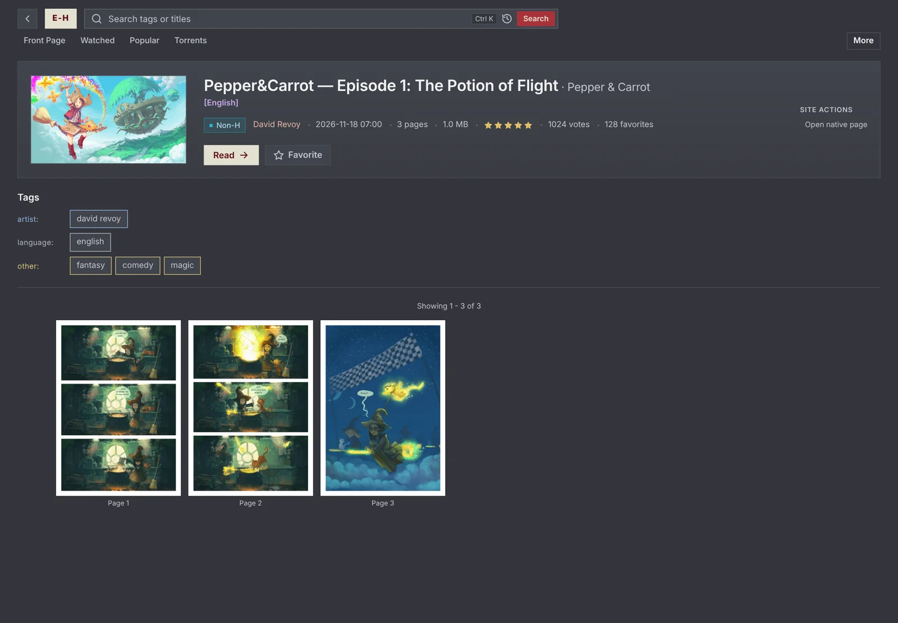

# Better EH

A full reskin of `e-hentai.org` and `exhentai.org`. Every page the script owns — search and
category listings, galleries, the reader, favorites, toplists, torrents and settings — renders as
one consistent, image-first interface instead of the site's legacy tables. Routes it does not own
stay native.


| Gallery                                                             | Reader                                              |
| ------------------------------------------------------------------- | --------------------------------------------------- |
|  |  |

<sub>Screenshots use Pepper&amp;Carrot demo data by David Revoy (CC BY 4.0).</sub>

## Features

- **One shell**: owned routes share the sticky header, pagination, empty/error panel and SPA
  transitions, including back/forward and per-entry scroll restoration. A `?eh_native=1` link
  always falls back to the site's own page.
- **Search and browse**: a cover grid that keeps each gallery's real thumbnail aspect, with
  category chips, rating/date/page-count metadata, favorite marks, result counts, infinite scroll
  (per view) and the site's own seek/jump. Advanced filters and the panel state are remembered.
- **Search expressions**: recent queries, named saved searches and quick tags share one store;
  active filter chips can be removed or flipped to include/exclude/optional without retyping.
- **Tag autocomplete**: namespace-aware suggestions, quoted/exact/signed terms, short aliases
  (`f:`, `a:`), popularity ranking and local usage learning. Clicking a gallery tag adds it to the
  current search; `Alt+click` excludes it.
- **Gallery**: parsed title hierarchy, grouped tags with actions, rating and comments (including
  editing your own), favorite folders with notes, archive/torrent links, resume position, and a
  sprite thumbnail grid with the site's pager.
- **Reader**: fit-height/zoom/pan or natural-width scrolling, single/spread/continuous layouts,
  right-to-left direction, prefetching, `nl` retry, original-file fallback on deep zoom, keyboard,
  click zones, edge chevrons and swipes.
- **Account pages**: favorites folders with search, notes, ordering and bulk move/delete; the
  ranked toplist overview and category pages; the torrent index with search, status, only-mine and
  sortable columns; `/uconfig.php` plus a userscript settings panel, keybinding editor and JSON
  backup.
- **Fast and robust**: request priorities and caching, rate-limit purge with a banner, result-card
  previews, and a login gate instead of a broken page when a route needs a session.
- **Accessible**: keyboard paths, managed dialog focus, forced-colors support, reduced-motion
  handling and touch targets that grow on coarse pointers.

## Controls

| Key                   | Action                             |
| --------------------- | ---------------------------------- |
| `→` / `D`             | Next page                          |
| `←` / `A`             | Previous page                      |
| `↓` / `S`             | Scroll down / pan down when zoomed |
| `↑` / `W`             | Scroll up / pan up when zoomed     |
| `F`                   | Toggle fit-height / natural-width  |
| `Space`               | Scroll a screen, then next page    |
| `Shift` + `Space`     | Scroll back, then previous page    |
| `R`                   | Reload the current image           |
| `Q` / `Esc`           | Return to the gallery              |
| `?`                   | List the reader shortcuts          |
| `Ctrl` + `+/-/Scroll` | Image zoom                         |
| `Ctrl` + `0`          | Reset zoom                         |
| Click left 30%        | Previous page                      |
| Click right 30%       | Next page                          |
| Click middle 40%      | Pin/unpin the HUD and page buttons |

`Ctrl/Cmd + K` focuses search. In the field, arrows and `PageUp`/`PageDown` move through
suggestions, `Enter` applies or submits, `Tab`/`Esc` close, and holding `Ctrl`/`Cmd` while choosing
inserts an exclusion.

## Installation

1. Install a userscript manager ([Violentmonkey](https://violentmonkey.github.io/) recommended).
2. Install from one of these sources:
   - **Sleazy Fork:**  
     `https://sleazyfork.org/en/scripts/606064-better-eh`
   - **Latest release:**  
     `https://github.com/identity-morphism/better-eh/releases/latest/download/better-eh.user.js`
   - **Raw master:**  
     `https://raw.githubusercontent.com/identity-morphism/better-eh/master/dist/better-eh.user.js`
3. First use downloads the compact tag vocabulary and popularity assets; suggestions work after
   those downloads, and search still works without them.

## Development

Requires [Bun](https://bun.sh/); `bun install` fetches the pinned toolchain.

```bash
bun run dev           # watch, rebuild and serve on :8080
bun run check         # format, lint and type check
bun run test          # fixture tests, one isolated global per file
bun run test:browser  # built userscript smoke gate (Playwright)
bun run release patch --push
```

See [Development](docs/DEVELOPMENT.md) for setup, the dev-server workflow, release rules and
storage/debugging notes, and [Architecture](docs/ARCHITECTURE.md) for the module map.

## Known Limits

- My Tags, My Home, `/mpv/` and `/lofi/` remain native; the gallery tag menu covers individual
  watch/hide/colour changes, while the full tagset manager stays on the native My Tags page.
- Toplists exist on e-hentai.org only; ExHentai answers `/toplist.php` with a 404, so the tab is
  hidden there.
- Gallery archive, torrent, report and petition actions link to the site's own pages rather than
  being rebuilt in-app.
- Date-range filtering stays unsupported: the site's search form exposes no date cursor to build
  on, so there is no list-side bar for it.
- Tag suggestions download a roughly 400 KB front-coded vocabulary asset (about 220 KB gzipped on
  the wire) on first use and cache it for a week. Popularity ranking fetches a roughly 14 KB binary
  asset and caches it for a week. Nothing is embedded in the bundle, so first use needs a successful
  download; without it, suggestions fall back to match quality and aliases.
- Site HTML changes can break parsers; keep the native escape path available.

## Data attribution

The project ships derived tag data and uses demo art from these community sources:

- **EhTagTranslation** — namespace and tag names come from
  [EhTagTranslation/Database](https://github.com/EhTagTranslation/Database) via its
  [DatabaseReleases](https://github.com/EhTagTranslation/DatabaseReleases) artifact. This project
  redistributes only the compact front-coded key list (`assets/tag-index.bin`), not the
  translations or descriptions.
- **e-hentai-tag-count** — gallery popularity counts come from
  [mokurin000/e-hentai-tag-count](https://github.com/mokurin000/e-hentai-tag-count), reduced to the
  compact `assets/tag-counts.bin` snapshot.
- **Pepper&Carrot** — the README screenshots use cover art and pages from
  [Pepper&Carrot](https://www.peppercarrot.com/) by David Revoy, licensed
  [CC BY 4.0](https://creativecommons.org/licenses/by/4.0/).

Both datasets remain the property of their upstream projects; their licenses and redistribution
terms govern the derived assets. The Pepper&Carrot art remains © David Revoy under CC BY 4.0.

## License

MIT — see [LICENSE](LICENSE).
