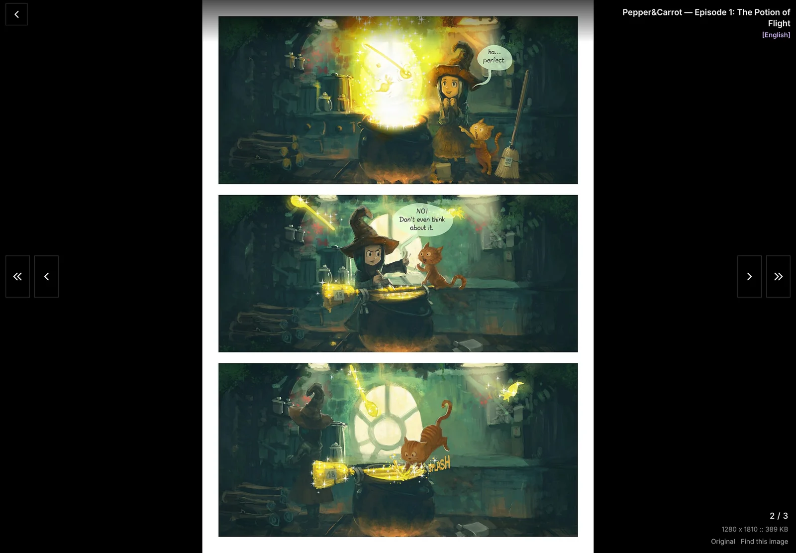
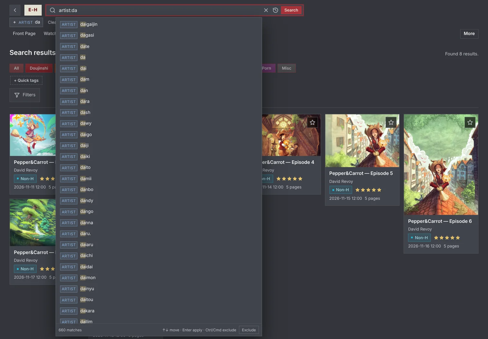

# Better EH

A full reskin of `e-hentai.org` and `exhentai.org`. Owned pages — listings, galleries, the reader,
favorites, My Home, toplists, torrents, gallery torrents, My Tags and settings — share one
image-first interface; every other route stays native.


| Gallery                                                             | Reader                                              |
| ------------------------------------------------------------------- | --------------------------------------------------- |
|  |  |

Tag completion in the search bar — namespace-aware, popularity-ranked, and reachable from `f:`/`a:` aliases:



<sub>Screenshots use Pepper&amp;Carrot demo data by David Revoy (CC BY 4.0).</sub>

## Features

- **One shell**: sticky header, pagination, empty/error panel and SPA transitions, including
  back/forward and per-entry scroll restoration. `?eh_native=1` falls back to the site's own page.
- **Browse**: cover grid at each gallery's real thumbnail aspect, category chips,
  rating/date/page-count metadata, favorite marks, result counts, per-view infinite scroll and the
  site's seek/jump; remembered filters and panel state. An app-owned `eh_since`/`eh_until` range
  narrows a listing client-side, so counts are approximate.
- **Tags**: namespace-aware autocomplete (quoted/exact/signed terms, `f:`/`a:` aliases, popularity
  ranking, local usage learning) from an embedded core vocabulary; quick tags and filter chips flip
  between include/exclude/optional without retyping. Clicking a gallery tag adds it to the search,
  `Alt+click` excludes it.
- **Gallery**: parsed title hierarchy, grouped tags with actions, rating and editable comments,
  favorite folders with notes, the in-app archive chooser (size and GP price) and torrent list,
  resume position, and a sprite thumbnail grid with the site's pager.
- **Reader**: fit-height/zoom/pan or natural-width scrolling in single, spread or continuous
  layout, right-to-left direction, prefetching, `nl` retry, original-file fallback on deep zoom,
  keyboard and click zones, edge chevrons, swipes and an optional timed slideshow.
- **Account**: My Home overview; favorites folders (search, notes, ordering, bulk move/delete);
  ranked toplists; torrent index (search, status, only-mine, sortable); `/uconfig.php`; My Tags
  editing; and a settings panel with keybinding editor and JSON backup. `/archiver.php`,
  `/gallerytorrents.php` and `/news.php` also render in-app.
- **Robust**: request priorities and caching, rate-limit purge with a banner, a Save-Data/2G gate
  over the background vocabulary and prefetch, and a login gate instead of a broken page.
- **Accessible**: keyboard paths, managed dialog focus, forced colors, reduced motion, coarse-pointer
  touch targets. The smoke gate runs axe with the WCAG A/AA rules, so a control that fails name,
  contrast or landmark checks fails CI.

## Controls

| Key                   | Action                             |
| --------------------- | ---------------------------------- |
| `→` / `D`             | Next page                          |
| `←` / `A`             | Previous page                      |
| `↓` / `S`             | Scroll down / pan down when zoomed |
| `↑` / `W`             | Scroll up / pan up when zoomed     |
| `F`                   | Toggle fit-height / natural-width  |
| `Space`               | Scroll a screen, then next page    |
| `Shift` + `Space`     | Scroll back, then previous page    |
| `R`                   | Reload the current image           |
| `Home` / `End`        | Jump to the first / last page      |
| `Q` / `Esc`           | Return to the gallery              |
| `?`                   | List the reader shortcuts          |
| `Ctrl` + `+/-/Scroll` | Image zoom                         |
| `Ctrl` + `0`          | Reset zoom                         |
| Click left 30%        | Previous page                      |
| Click right 30%       | Next page                          |
| Click middle 40%      | Pin/unpin the HUD and page buttons |

`Ctrl/Cmd + K` focuses search. In the field, arrows and `PageUp`/`PageDown` move through
suggestions, `Enter` applies or submits, `Tab`/`Esc` close, and holding `Ctrl`/`Cmd` while choosing
inserts an exclusion.

## Installation

1. Install a userscript manager ([Violentmonkey](https://violentmonkey.github.io/) recommended).
2. Install from one of these sources:
   - **Sleazy Fork:**  
     `https://sleazyfork.org/en/scripts/606064-better-eh`
   - **Latest release:**  
     `https://github.com/identity-morphism/better-eh/releases/latest/download/better-eh.user.js`
   - **Raw master:**  
     `https://raw.githubusercontent.com/identity-morphism/better-eh/master/dist/better-eh.user.js`

Tag suggestions start from an embedded core; the full index downloads in the background. Search
works without either download.

## Development

Requires [Bun](https://bun.sh/); `bun install` fetches the pinned toolchain.

```bash
bun run dev         # watch, rebuild and serve on :8080
bun run check       # format, lint and type check
bun run test        # fixture tests, one isolated global per file
bun run release patch --push
```

[Development](docs/DEVELOPMENT.md) covers the browser smoke gate, releases and debugging.
[Architecture](docs/ARCHITECTURE.md) maps the modules.

## Known Limits

- `/lofi/` stays native: a separate mobile listing, gallery and reader under its own URL space.
  `/mpv/` no longer exists on the site (404).
- My Home is read-only. Actions that spend GP or reset account state — quota unlock,
  personalized-torrent key reset — open the native page.
- Toplists are an e-hentai.org feature; ExHentai answers `/toplist.php` with a 404, so the tab is
  hidden there.
- Gallery report and petition actions link to the site's own pages.
- Tag data: the embedded core holds about 1,500 popular tags (~30 KB of source). The full ~400 KB
  front-coded index (~220 KB gzipped) downloads after the first owned page renders, replaces the
  core and is cached a week; popularity (~14 KB) is fetched separately, also cached a week. A failed
  download leaves the core, so less-common tags stay missing until a retry succeeds.
- The reader has no page-jump strip: a viewer document carries only the current page's links, so a
  jump needs the gallery's page list or another fetch. Gallery thumbnails remain the jump surface.
- Dark theme only: every token compiles from one palette, so a light/system theme needs a second
  token set plus its own forced-colors and contrast audits.
- Site HTML changes can break parsers; the native escape path stays available.

## Contributing

Bug reports and pull requests are welcome; [CONTRIBUTING.md](CONTRIBUTING.md) has the local checks,
fixture rules and the `dist/` rebuild rule, and [Development](docs/DEVELOPMENT.md) the release
detail. Report security problems through
[advisories](https://github.com/identity-morphism/better-eh/security/advisories/new), not an issue.
Strip session values from logs and screenshots before posting.

## Data attribution

- **EhTagTranslation** — namespace and tag names come from
  [EhTagTranslation/Database](https://github.com/EhTagTranslation/Database) via its
  [DatabaseReleases](https://github.com/EhTagTranslation/DatabaseReleases) artifact. This project
  redistributes only the compact front-coded key list (`assets/tag-index.bin`).
- **e-hentai-tag-count** — gallery popularity counts come from
  [mokurin000/e-hentai-tag-count](https://github.com/mokurin000/e-hentai-tag-count), reduced to the
  compact `assets/tag-counts.bin` snapshot.
- **Pepper&Carrot** — the README screenshots use cover art and pages from
  [Pepper&Carrot](https://www.peppercarrot.com/) by David Revoy, licensed
  [CC BY 4.0](https://creativecommons.org/licenses/by/4.0/).

The derived assets remain governed by their upstream licenses and redistribution terms. The
Pepper&Carrot art remains © David Revoy under CC BY 4.0.

## License

MIT — see [LICENSE](LICENSE).
